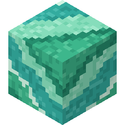

  

<h1 align="center">Fluorite Launcher</h1>

A Minecraft: Java Edition launcher for Windows.

  
  
  

<b>English</b> · <a href="README.zh-Hans.md">简体中文</a>

> NOT AN OFFICIAL MINECRAFT PRODUCT. NOT APPROVED BY OR ASSOCIATED WITH MOJANG OR MICROSOFT.

## Features

- **Every version**, from the earliest `rd-132211` build to the latest 26.x releases.
- **Every major mod loader**: Fabric, Quilt, Legacy Fabric, Forge, NeoForge, LiteLoader and OptiFine. Pick one when you create an instance and Fluorite installs it the first time you play.
- **Mods, resource packs, shaders and data packs** from Modrinth and CurseForge. Required dependencies are installed for you, and updates show their changelogs.
- **Modpacks** from Modrinth, CurseForge, FTB, Technic, Prism/MultiMC and packwiz. Updating a pack keeps the files you changed. You can export any instance as a Modrinth, CurseForge, Prism or packwiz pack.
- **Your other launchers, as they are.** Fluorite plays instances from the official launcher, HMCL/PCL and Prism/MultiMC right where they are, without copying them, and never deletes them. You can also import from the CurseForge app, Modrinth App, GDLauncher, ATLauncher and FTB App.
- **Accounts**: Microsoft, skin sites such as LittleSkin and Ely.by, and offline accounts with skins once a Microsoft account that owns the game is signed in.
- **Java is handled for you.** Fluorite picks the right Java for each version and downloads it if needed.
- **Fast downloads in mainland China** through the BMCLAPI and MCIM mirrors.
- English and Simplified Chinese.

## Requirements

Windows 10 version 2004 or later, or Windows 11, on x64 or ARM64.

## Download

Fluorite is still in development and hasn't been released yet. It will come to the Microsoft Store first. Until then, you can build it yourself; see [CONTRIBUTING.md](CONTRIBUTING.md).

## Where your data lives

Fluorite keeps its instances and downloads in `%LOCALAPPDATA%\FluoriteLauncher`. You can move this folder in **Settings**.

## Privacy

Fluorite has no telemetry or analytics, and its developers don't run any servers. See the [Privacy Policy](PRIVACY.md) and the [Terms of Use](TERMS.md).

## License

Fluorite Launcher is free software under the GNU General Public License v3.0 (see [LICENSE](LICENSE)). It bundles Prism Launcher's built-in instance icons (GPL-3.0, with MultiMC's Apache-2.0 originals); see [THIRD-PARTY-NOTICES.md](THIRD-PARTY-NOTICES.md).
