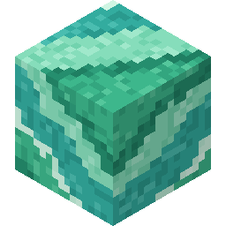

  

<h1 align="center">Fluorite Launcher</h1>

适用于 Windows 的 Minecraft: Java 版启动器。

  
  
  

<a href="README.md">English</a> · <b>简体中文</b>

> 非 Minecraft 官方产品。未经 Mojang 或 Microsoft 批准，也与 Mojang 或 Microsoft 无关。

## 功能

- **支持所有版本**：从最早的 `rd-132211` 到最新的 26.x 正式版。
- **支持所有主流模组加载器**：Fabric、Quilt、Legacy Fabric、Forge、NeoForge、LiteLoader 和 OptiFine。创建实例时选好加载器，首次启动时 Fluorite 会自动安装。
- **模组、资源包、光影和数据包**：来自 Modrinth 和 CurseForge。前置依赖会自动安装，更新时可以查看更新日志。
- **整合包**：支持 Modrinth、CurseForge、FTB、Technic、Prism/MultiMC 和 packwiz。更新整合包时会保留你改过的文件。任何实例都可以导出为 Modrinth、CurseForge、Prism 或 packwiz 整合包。
- **直接使用其他启动器的游戏目录。** 官方启动器、HMCL/PCL 和 Prism/MultiMC 的实例可以原地启动，无需复制，Fluorite 也绝不会删除它们。还可以从 CurseForge App、Modrinth App、GDLauncher、ATLauncher 和 FTB App 导入。
- **账户**：Microsoft 账户、LittleSkin 和 Ely.by 等皮肤站（外置登录），以及离线账户。登录一个拥有正版游戏的 Microsoft 账户后即可使用离线账户，并且离线账户也能用自定义皮肤。
- **无需操心 Java。** Fluorite 会为每个版本选择合适的 Java，需要时自动下载。
- **中国大陆高速下载**：支持 BMCLAPI 和 MCIM 镜像。
- 支持英文和简体中文。

## 系统要求

Windows 10 2004 或更高版本，或 Windows 11；x64 或 ARM64。

## 下载

Fluorite 仍在开发中，尚未发布，正式版将首先上架 Microsoft Store。在此之前，你可以自行构建，参见 [CONTRIBUTING.md](CONTRIBUTING.md)（英文）。

## 数据存放位置

Fluorite 将实例和下载的文件保存在 `%LOCALAPPDATA%\FluoriteLauncher`。你可以在 **设置** 中移动这个文件夹。

## 隐私

Fluorite 没有遥测或统计功能，开发者也不运营任何服务器。详见 [隐私政策](PRIVACY.md) 和 [使用条款](TERMS.md)（英文）。

## 许可证

Fluorite Launcher 是自由软件，以 GNU 通用公共许可证第 3 版（GPL-3.0）发布（见 [LICENSE](LICENSE)）。它包含 Prism Launcher 的内置实例图标（GPL-3.0，部分原图来自 MultiMC，采用 Apache-2.0 许可证），详见 [THIRD-PARTY-NOTICES.md](THIRD-PARTY-NOTICES.md)。
